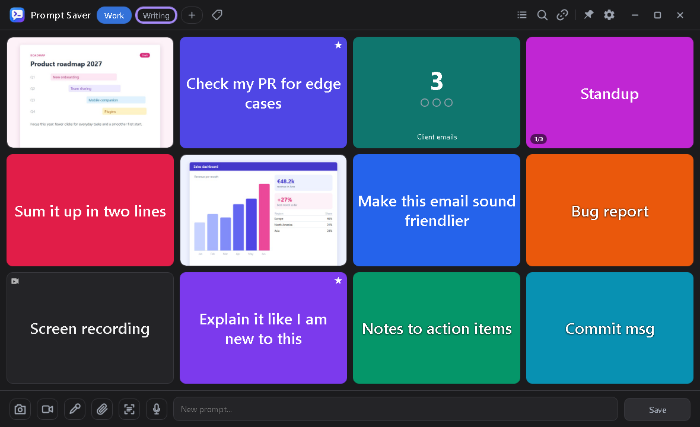

<div align="center">

# Prompt Saver

**Your prompts, one click away — from a grid, from the search, or from a floating button over any app.**

A tiny, fully offline prompt manager for Windows. No account, no cloud, no telemetry.

[](../../releases/latest)
[](../../releases)




</div>

---

## Why

- **Faster than a notes file** — click a tile, the text is in your clipboard.
- **Always within reach** — pin prompts as floating buttons that stay on top of every other window.
- **Yours alone** — everything lives in a local file. The app only goes online if you let it check for updates.

## Features

### 🗂️ Organise

| | |
|---|---|
| **Grid & views** | Free placement on a per-view grid (1×1 up to 20×20), drag tiles anywhere, drop on an occupied cell to swap. Up to 20 named views, each with its own size and layout. Drop a tile on a view tab to move it into that view, Ctrl to copy it there instead; hovering a collapsed view group opens it |
| **Library** | Every saved prompt in one searchable list — copy, edit, drag onto the grid, filter by color or type |
| **Search & sort** | Typo-tolerant search ("promt" still finds "prompt"), sorted by most used or recently used |
| **Saved searches** | Star a query, its tag filters and sort to bring it back with one click from a chip above the search field |
| **Library tiles** | Switch the library from a list to big preview tiles, name below, same click/select/right-click behavior either way |
| **Tags** | Label prompts with your own colored tags and narrow the library down to any combination of them |
| **Archive** | Set a prompt aside without deleting it — hidden from the library and grid, still findable by search and included in export and backups |
| **View groups** | Drag one view tab onto another to collect them into a folder tab with a member popover |
| **Private notes** | A notes field per prompt for context you keep but never copy — searchable, shown in the tooltip |
| **Favorites** | Star prompts for a live favorites view |
| **Batch editing** | Multi-select in the library to recolor, favorite, move between views, export or delete in one go |
| **Undo** | Deleting a view, clearing the copy history, clearing the clipboard inbox, deleting a tag, or a batch delete or tag change offers an Undo button right on the confirmation |
| **Duplicate finder** | Finds near-identical prompts, shows them side by side, keeps the one you pick; the same threshold also drives a quiet "similar to..." hint right after saving a prompt |

### ⚡ Copy

| | |
|---|---|
| **One click** | Click a tile — the text is copied, a bubble confirms it |
| **Floating buttons** | Pin any prompt as a frameless, always-on-top pill. Drag to move, right-click for size, edit or remove; positions survive restarts |
| **Auto-paste** | A fast second click (or Enter) copies **and** pastes into the app you were just in |
| **Variables** | Write `{#{Name}#}` placeholders and fill them in on copy — or `{#{tone\|formal,casual}#}` for a dropdown; an optional fixed-value list suggests a value for a name you use often, shown only as a placeholder |
| **Self-filling** | `date`, `time`, `weekday`, `clipboard` and `uuid` fill themselves in, no dialog, in your language |
| **Rotating prompts** | Give a prompt a list of texts instead of one — each copy serves the next entry, in order or shuffled, with a small badge showing where you are |
| **Prompt hotkeys** | Give a prompt its own global key combination that copies — and optionally pastes — from any app, with a small keyboard badge on its tile |
| **Tray menu** | Copy a recent or favorite prompt straight from the tray, without opening the window; a filter field at the top searches every prompt as you type |
| **Drag-out** | Ctrl-drag a tile, library row or floating button into any other app to drop its text |
| **Button folders** | Drag one floating button onto another and they merge into a folder that opens in place |
| **Chaining** | Combine several prompts into one clipboard entry |
| **Copy formatted** | For a prompt with real Markdown syntax: a second copy that puts the rendered version on the clipboard too, so Word, Outlook or a browser shows the formatting while a plain text field still gets the Markdown source |
| **Copy history** | A journal of recent and most-used prompts, with optional timestamps and adjustable retention |
| **Clipboard inbox** | An optional watcher collects text you copy anywhere, so you can turn the good bits into prompts later |

### 🖼️ More than text

| | |
|---|---|
| **Images, GIFs & videos** | Save a picture from the clipboard or a file and paste it anywhere with one click |
| **Video player** | Looping previews on tiles *and* floating buttons, with scrubber, loop and volume — remembered per prompt |
| **PDF & files** | Attach any file by path; a PDF's first page becomes the button's image. A plain text, Markdown, JSON or CSV attachment also previews its start in the editor, as plain text, never rendered |
| **Screenshot tool** | Capture a region or a whole window — even protected ones like the Task Manager |
| **Screen recording** | Record a window, a dragged region or the whole screen to MP4, with system and microphone audio (both on by default), a small floating control bar with optional stop/pause hotkeys and tray entries, and an optional conversion afterward to WebM, AVI, MOV, MKV, animated WebP or APNG |
| **Video editor** | Trim, crop, change speed, fade, resize (width/height/percent fields, an aspect-ratio lock, and presets from 4K down to 25%) and add image/freeze-frame/text/pixelate/spotlight/video overlays on a recording or any attached video, on a zoomable filmstrip-and-waveform timeline with a live preview (itself zoomable and pannable) and no processing until export; drag a crop box or overlay and it snaps to the frame edges, its centre and other overlays; right-click an overlay to duplicate or delete it, nudge or resize a selected one with the arrow keys, and each overlay kind remembers its last colour, thickness, opacity and font size for the next one; "Add a video" can also splice a second video in as a whole extra section at the start, the end or the current position, normalized to the main video's own size, rate and sound; a toolbar button (or the V key) compares against the untouched source, held for a peek or tapped to lock it on; exports to MP4, WebM, GIF, AVI, MOV, MKV, animated WebP or APNG |
| **Screenshot editor** | Opens right after a capture: crop, pen, marker, line, arrow, rectangle, ellipse, text (with a choice of no background, a solid plate or an outline behind the letters), step numbers, pixelate, spotlight, resize (the image's actual pixel size, with width/height/percent fields and presets) and a hand tool to pan while zoomed in, with undo/redo, snapping to the canvas edges, its centre and other shapes, a right-click menu to duplicate or delete a shape, arrow keys to nudge or resize a selected one, and a toolbar button (or the V key) to compare against the untouched capture, before it becomes a copy button. Either editor can also open an existing picture or video (right-click the screenshot/record button or a library attachment), never touching the original — it works on a copy and asks where to save the result |
| **Text recognition (OCR)** | Pull text out of a screenshot or an image file with Windows' own on-device recognizer — fully offline, nothing uploaded. On by default; needs a Windows language pack, which the app offers to install for you (needs administrator rights — including for the listing itself, on systems where Windows demands them) |
| **Voice dictation** | Speak into the composer or the editor with Windows' own on-device speech recognizer — fully offline, nothing uploaded unless you allow online recognition. Spoken punctuation and formatting commands, auto-capitalization and a global hotkey included. On by default; shares OCR's language-pack dialog |
| **Color picker** | A pipette freezes the screen, magnifies the pixel under the cursor and copies it as hex, rgb or hsl |
| **Markdown preview** | Render a prompt in the editor — headings, lists, quotes and syntax-colored code, toggled or side by side |
| **Full-screen viewer** | Click any preview to open it full-screen: scroll to zoom up to 8×, drag to pan |

### 🎨 Make it yours

| | |
|---|---|
| **8 themes** | Light, dark and system (live OS detection), plus Programmer, Neon Violet, Ocean, Cyberpunk and Black & White — or build your own in the theme editor |
| **Custom themes** | Build your own on top of any built-in one — a color per value, grouped and previewed live |
| **Colors & fonts** | Tint tiles and pills from a palette or a color picker; 20 fonts, per prompt if you like |
| **Auto-fit text** | Tile text grows to fill the button, or pick a fixed size |
| **Scaling** | Separate size control for UI, popups, icons and buttons — from 50 % up |
| **Distraction-free** | Hide the top and bottom bars; the grid takes over the freed space |
| **11 languages** | Auto-detected from the system: EN, DE, ES, IT, PT, PL, ZH, JA, NL, TR, RO |

### 🛟 Keep it safe

| | |
|---|---|
| **Backups** | Rotating local snapshots, compressed and encrypted, on a schedule you can change or switch off. Diagnostics, a restore list, usage statistics (exportable as CSV, TXT or JSON, including which tools get used most) and a storage breakdown (database, attachments, screenshots, recordings, backups, temporary files, error log, each with its own folder) live in their own window |
| **Smart retention** | Keep a plain number of snapshots, or a number per day, week, month and year |
| **Backup password** | Optional — protects new backup files with a key derived from your password |
| **Version history** | Every prompt keeps its earlier versions; preview and restore any of them |
| **Editor draft autosave** | The open editor saves its text every few seconds so a crash or a closed window never loses unsaved work; a save or cancel removes the draft, and the next start asks once whether to restore one it still finds |
| **Import / export** | One backup file with prompts, views, layouts, colors, styles and language. Plain CSV/TXT export for the texts alone |
| **Careful resets** | "Delete data" and "Reset settings" are separate, both guarded, both with an optional safety backup |

### ⚙️ Under the hood

| | |
|---|---|
| **Expert menu** | Six tabs with an on/off switch for every feature and a parameter for everything adjustable. Settings that are not self-explanatory carry a tooltip |
| **Runs in the background** | Optional minimize-to-tray, autostart at login, global hotkey |
| **Guided first run** | A short walkthrough on first launch covering the basics, with a step to turn on the screenshot editor, color picker, OCR or voice dictation right there; reopen it anytime from Settings |
| **Auto updates** | Checks for a new version on start (switchable off) with one-click install, verified against a published checksum |
| **What's new** | A small notice after an update lists what changed since the version you last saw, from a list shipped with the app; reopen the current version's list anytime from the About dialog |
| **100 % local** | A single local database, sealed with Windows' own per-account encryption so no other account on the PC can read it. On the rare machine where Windows refuses to encrypt (a damaged user profile), saving keeps working in readable form rather than losing the data — and the app says so on startup and permanently in the privacy settings, until the next successful save seals it again. No account, no telemetry, no network traffic except the update check and, only if video export needs ffmpeg and it isn't already present, a one-time optional download you explicitly approve |
| **Small** | ~8 MB installer (Rust / Tauri), using the Windows WebView2 runtime |

## Download

From the [latest release](../../releases/latest):

| File | What it is |
|---|---|
| `Prompt.Saver_<version>_x64-setup.exe` | **Installer** — all users or current user only, optional desktop / start-menu shortcuts, upgrades keep your data |
| `prompt-saver.exe` | **Portable** — one standalone exe, no installation, keeps its data next to itself |

Both need the Microsoft WebView2 runtime (preinstalled on Windows 11 and current Windows 10; the app offers Microsoft's installer if it is missing).

Full version history: [CHANGELOG.md](CHANGELOG.md)

## Usage

| Action | How |
|---|---|
| Save a prompt | Type it in the input line → **Save** → name + color (Ctrl+Enter works too) |
| Copy a prompt | Click its tile |
| Move a tile | Drag it to any grid cell; drop on an occupied cell to swap, or onto a view tab to file it there (Ctrl to copy) |
| Edit / hide / pin / delete | Right-click a tile (or hover **⋮**); deleting asks twice |
| All prompts | List icon in the header: search, edit and place every prompt |
| Screenshot | Camera icon: drag a region or click a window to save it as a copy button |
| Screen recording | Record icon next to the camera: pick a window, region or the whole screen, then Stop to save, copy, edit or discard |
| Video editor | Edit button in a recording's result dialog, or "Edit video" on any video prompt's right-click menu |
| Floating button | "Toggle floating button" in the tile menu; right-click the pill for options |
| Views | Tabs next to the title: **+** adds one; right-click a tab to rename, resize, recolor or delete |
| Settings | Gear icon: theme, language, fonts, sizes, autostart, hotkey, import/export, updates, reset |
| Backups | **Backup manager** in the settings: schedule, retention, password, restore list and statistics |
| Help | **Help** button in the settings: what every feature and setting does, also readable at [docs/help.md](docs/help.md) |

## Building from source

Requirements: [Node.js](https://nodejs.org), [Rust](https://rustup.rs) (MSVC toolchain).

PDF previews are rendered by PDFium, which is compiled into the exe. Download
`pdfium.dll` (x64) from [pdfium-binaries](https://github.com/bblanchon/pdfium-binaries/releases)
and put it in `src-tauri/` before building — the build fails without it.

Video export/conversion shells out to ffmpeg, which the installer ships as a
plain file rather than compiling in. Download the gyan.dev "essentials" build
(currently pinned to release
[9.0.1](https://github.com/GyanD/codexffmpeg/releases/tag/9.0.1)), extract
`ffmpeg.exe` from the zip's `bin/` folder and put it in `src-tauri/` before
building — the installer bundle step fails without it (the portable exe still
builds fine; it offers to download ffmpeg itself on first need instead).

```bat
build.bat
```

This is the canonical build path: it regenerates the app icons, builds both the
portable exe and the NSIS installer, writes a `.sha256` sidecar next to the
installer (checked by the in-app updater), and copies everything into `dist/`.

or manually:

```sh
npm install
npm run build              # portable exe + NSIS installer
# -> src-tauri/target/release/prompt-saver.exe
# -> src-tauri/target/release/bundle/nsis/Prompt Saver_<version>_x64-setup.exe
```

### Running the tests

```sh
cargo test --lib                        # in src-tauri/
node --check ui/main.js
node tests/i18n_check.js
node tests/terms_check.js
node tests/voice_check.js
python tests/source_hygiene.py          # no process traces in shipped source
python tests/flag_polarity.py           # no feature gate that can never fire
python tests/expert_menu_check.py
python tests/tooltip_check.py
python tests/layout/modal_scroll_test.py
python tests/ui/smoke_test.py
python tests/perf_hot_paths.py          # times four hot paths against 1000 prompts
```

A large library behaves differently from a handful of prompts. `python
tests/gen_perf_corpus.py` writes `test-data/data.db` — 500 prompts, 60 of them
carrying a full-size stored image — so the grid and the library can be measured
against a realistic store instead of a demo one. `test-data/` is ignored by git;
point the app's data folder at it, or copy the file next to the portable exe.

## Tech stack

[Tauri 2](https://tauri.app) (Rust backend, WebView2 frontend) · vanilla HTML/CSS/JS, no bundler, no framework · SQLite store · `arboard` (clipboard), `rfd` (native dialogs), `pdfium-render` (PDF previews), `xcap` (screenshots), `windows-capture` (screen recording), `winreg` (autostart), `sys-locale` (language detection), `windows` (on-device OCR, WASAPI audio), `zip` (ffmpeg/ffprobe download extraction).

Third-party components and their licenses: [THIRD-PARTY-NOTICES.md](THIRD-PARTY-NOTICES.md)

## Copyright

© 2026 BGCoding. The source is published so anyone can see what the app does with
their data — it is not released for reuse, redistribution or derivative works.
